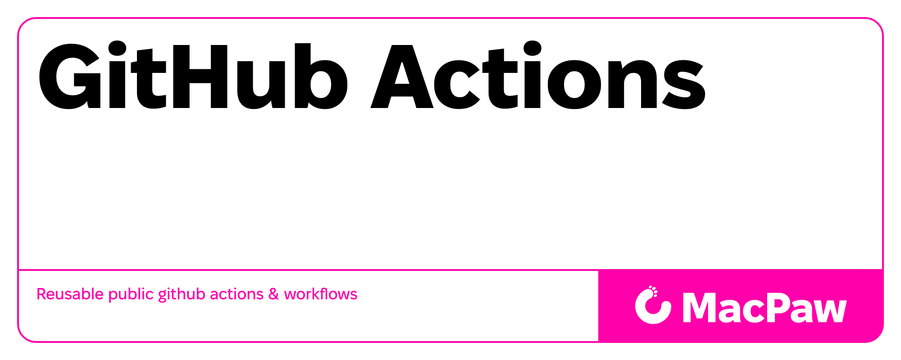

# Reusable GitHub Actions & Workflows

## Repository contains reusable GitHub Actions workflows

This repository provides production-ready, reusable GitHub Actions workflows for Symfony PHP projects, consolidating best practices from MacPaw's public repositories.

### Workflows

All reusable workflows are located in `.github/workflows` folder

- [symfony-php-reusable.yml](.github/workflows/symfony-php-reusable.yml) - Comprehensive Symfony PHP quality checks and testing workflow
  - 🔍 **Code Quality** - PHPStan, PHPCS, PHP-CS-Fixer, Rector, Infection
  - 🧪 **Multi-Version Testing** - PHP 7.4-8.4, Symfony 4.4-7.3
  - 📊 **Code Coverage** - Xdebug + Codecov integration
  - 🎯 **Custom Matrix Exclusions** - Flexible version compatibility
  - 🔧 **Custom Config Files** - Custom configuration paths for all quality tools
  - ⚙️ **Configurable Thresholds** - Custom Infection MSI thresholds
  - ⚡ **Performance Optimized** - Parallel execution, intelligent caching
  - [📚 Detailed Documentation](docs/workflows/symfony-php-reusable.md)

### Documentation

- [Symfony PHP Reusable Workflow](docs/workflows/symfony-php-reusable.md) - Complete workflow documentation with:
  - 📥 All input parameters and configuration options
  - 🚀 Multiple usage examples (basic, minimal, full, extended matrix)
  - 🔄 Workflow diagram and process details
  - 🎯 Matrix strategy and custom exclusions
  - 🛠️ Advanced features and optimizations
  - 🚨 Prerequisites and required configuration files
  - 🔧 Troubleshooting guide
  - 📊 Analysis of MacPaw's Symfony repositories
  - 📈 Best practices and recommendations

### Contributing

Contributions are welcome! When adding new features:

1. Test across multiple PHP/Symfony version combinations
2. Update documentation to reflect changes
3. Maintain backward compatibility
4. Add usage examples
5. Update analysis documentation if adding new tools

### License

This project is licensed under the MIT License - see the [LICENSE](LICENSE) file for details.

### Security

For information about reporting security vulnerabilities, please see our [Security Policy](SECURITY.md).

### Resources

- [MacPaw GitHub Organization](https://github.com/MacPaw/)
- [GitHub Actions Documentation](https://docs.github.com/en/actions)
- [Symfony PHP Package reusable workflow](docs/workflows/symfony-php-reusable.md)
- [Repository Analysis](ANALYSIS.md)
